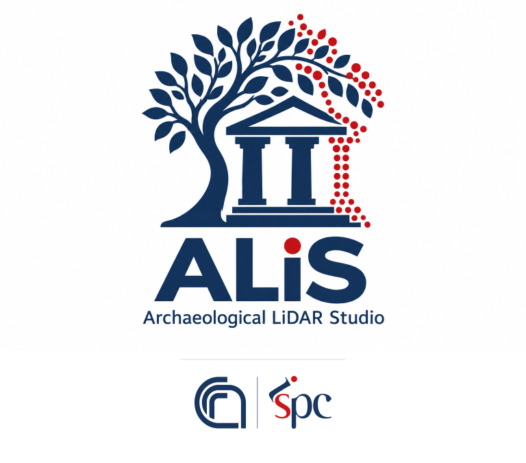
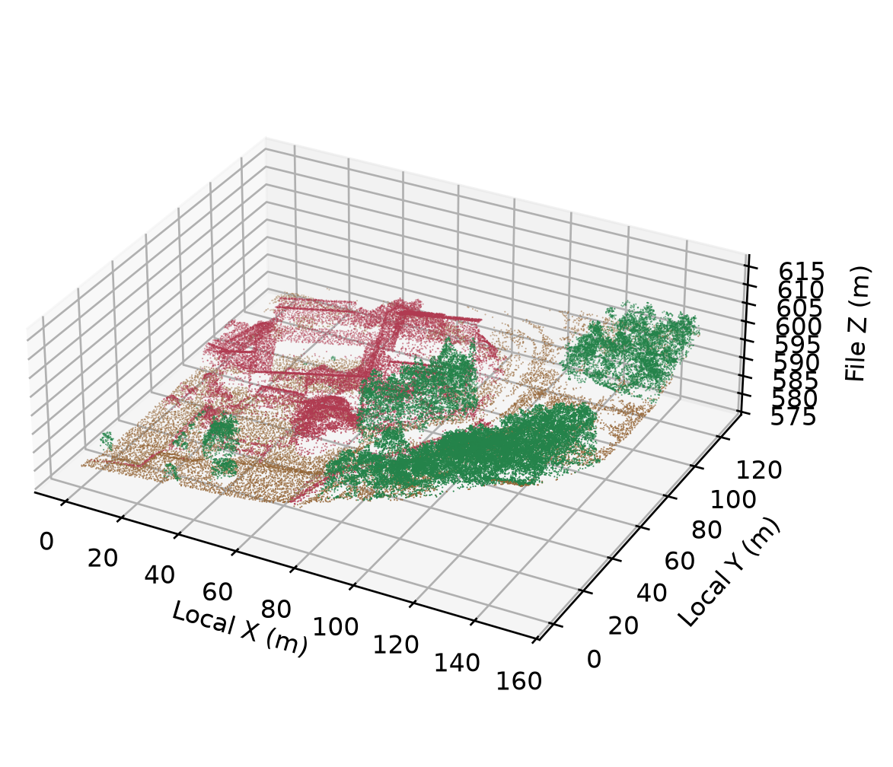
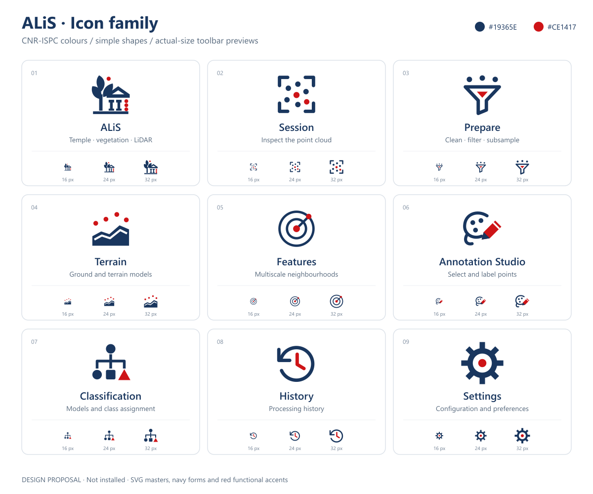
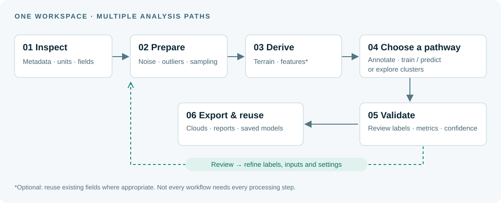
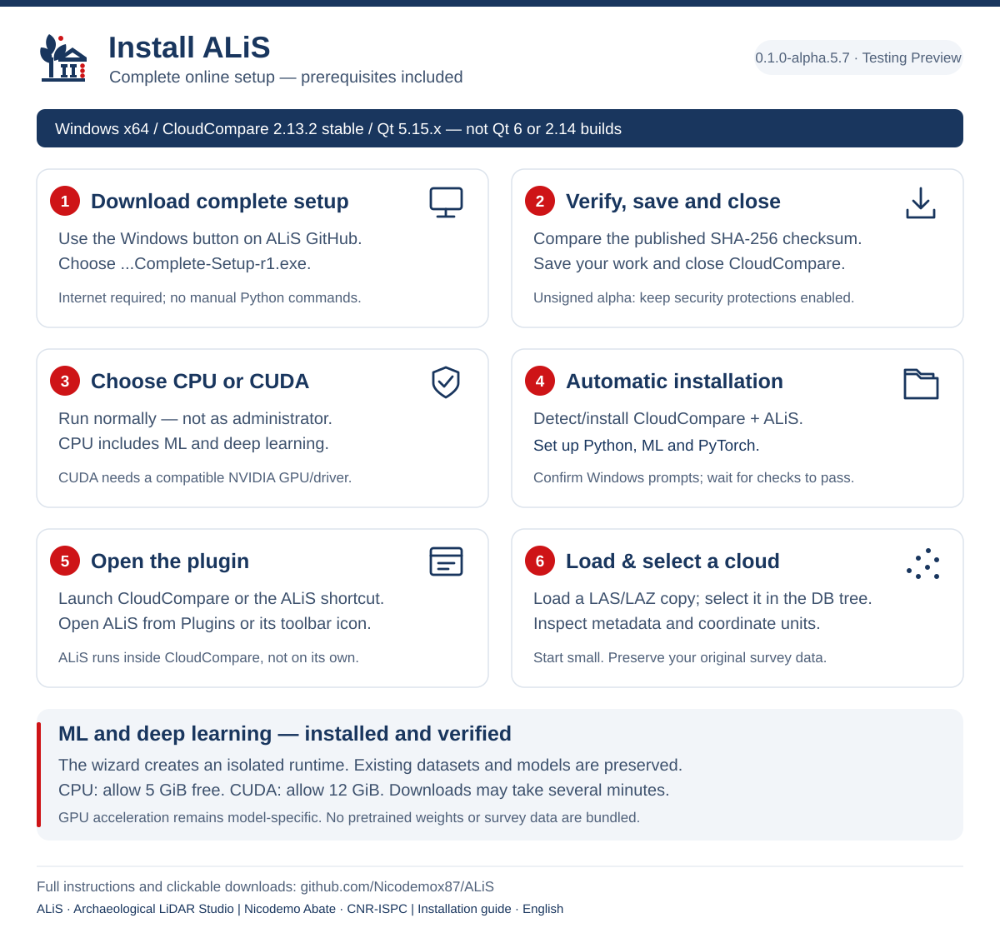

  

  <strong>Archaeological point-cloud analysis for Windows and macOS, powered by CloudCompare.</strong> 
  Prepare data. Explore geometry. Annotate, classify and validate.

  
  
  
  
  
  

  <a href="https://github.com/Nicodemox87/ALiS/releases/download/v0.1.0-alpha.5.7/ALiS-0.1.0-alpha.5.7-Windows-x64-Complete-Setup-r1.exe"><strong>Download Windows installer</strong></a> ·
  <a href="https://github.com/Nicodemox87/ALiS/releases/download/v0.1.0-alpha.5.7/ALiS-0.1.0-alpha.5.7-macOS-arm64-Setup.pkg"><strong>Download macOS installer</strong></a> ·
  <a href="#getting-started">Getting started</a> ·
  <a href="#capabilities">Capabilities</a> ·
  <a href="#workflow">Workflow</a> ·
  <a href="https://github.com/Nicodemox87/ALiS/releases">Releases</a> ·
  <a href="https://doi.org/10.5281/zenodo.22934837">Zenodo DOI</a> ·
  <a href="https://github.com/Nicodemox87/ALiS/issues">Report an issue</a>

---

## Why ALiS?

**New to ALiS? Choose your platform:** [Windows complete installation guide](docs/WINDOWS_COMPLETE_INSTALLER.md) · [macOS installation guide](docs/MAC_INSTALLER.md). Each platform has its own installer and requirements.

Archaeological LiDAR interpretation is not just a classification problem. It requires checking the data, separating terrain from vegetation and structures, choosing meaningful spatial scales, and reviewing uncertain results.

**ALiS brings these steps into a connected CloudCompare workflow**, combining geometric analysis, expert annotation and reusable classification models. Its purpose is to support interpretation and reproducible analysis—not to replace archaeological judgement.

> **Public testing version: 0.1.0-alpha.5.7.** Source, installer and manual-install package are available below. This is a research alpha, not a production-certified release.
>
> **Windows and macOS downloads are available separately.** The Windows complete online wizard detects or installs CloudCompare 2.13.2, installs ALiS and prepares Python with ML/deep learning. The Mac package includes CloudCompare, Python and all six classifiers; it requires **Apple Silicon and macOS 27 or later**. This Mac preview is unsigned by Apple and is not notarized.
>
> **Research alpha:** outputs require operator review. Performance on one survey does not establish accuracy on a different site, sensor or acquisition configuration.

  

<strong>Piazza Armerina, Sicily.</strong> Display-sampled view of the manually labelled reference cloud: ground (brown), vegetation (green), buildings (red). This is a dataset illustration, not an automatic-classification result or an application screenshot.

## Capabilities

  

| Workspace | What you can do |
| :--- | :--- |
| **Session & display** | Inspect cloud statistics and available metadata; display RGB or scalar fields; adjust palettes and ranges. Cached statistics avoid unnecessary recalculation. |
| **Preparation** | Access CloudCompare outlier, noise and subsampling tools; retain control over the data used downstream. |
| **Terrain** | Apply cloth simulation filtering (CSF) or progressive morphological filtering; review ground labels; derive a DTM and height above ground where supported. |
| **Multiscale features** | Compute geometric descriptors and neighbourhood statistics at selected scales; inspect the resulting scalar fields. |
| **Annotation Studio** | Work with simultaneous views and movable metric sections; select points with rectangle, polygon, lasso and similarity tools; assign and review labels. |
| **Classification** | Train, compare and reuse supervised models; cluster existing RGB/scalar-field inputs; explore vegetation–structure separation with manual review. |
| **Validation & reuse** | Inspect metrics, confusion matrices and confidence; export reports; retain models and their metadata in a local catalogue. |

## Workflow

  

**Choose only the steps your task needs.** Existing scalar fields can be used for clustering without recomputing features. Manual review is part of the process: a vegetation–structure proposal is not a verified archaeological interpretation.

## Classification, with the differences made explicit

| Approach | Available methods in this alpha | Intended use |
| :--- | :--- | :--- |
| **Supervised machine learning** | Random Forest, Extra Trees, Histogram Gradient Boosting, XGBoost | Learn from labelled examples, assess held-out performance and reuse compatible saved models. |
| **Neural classification** | Descriptor-based MLP; experimental PointNet-style local XYZ network | Compare learned nonlinear or local spatial representations with descriptor-based models. |
| **Unsupervised clustering** | MiniBatch K-Means, BIRCH, Gaussian Mixture | Explore groups in selected inputs. Cluster IDs are not automatically semantic or ASPRS classes. |
| **Vegetation / structures** | Adaptive geometric proposals and feature-range review | Assist separation after ground extraction, retaining uncertain points for validation. Remaining points are not automatically buildings. |

<strong>Deep learning and GPU: what is—and is not—included</strong>

The PointNet-style classifier operates on local XYZ neighbourhoods. It is **not canonical PointNet with T-Nets, PointNet++, or a bundled pretrained foundation model**. No external pretrained weights are supplied.

**On macOS, this preview runs the classifiers on CPU; CUDA is unavailable and Metal/MPS acceleration is not enabled.** On Windows, supervised CUDA paths are available for XGBoost, MLP and the local PointNet-style model when their dependencies, driver and GPU are compatible. Other operations remain CPU-based; PointNet neighbourhood lookup also uses the CPU. GPU acceleration is not a blanket guarantee of faster processing.

<strong>Validation and responsible interpretation</strong>

- Keep training and test data separate; favour spatially separated evaluation or an independent labelled cloud over testing on training points.
- Inspect per-class metrics and confusion matrices, not only overall accuracy.
- Model confidence is not necessarily a calibrated probability of correctness.
- Density, sampling geometry, occlusion, return metadata and feature scales affect model transfer.
- Review ground labels before terrain modelling, particularly below vegetation and near structures.
- Generalisation to independent archaeological sites remains an evaluation objective, not an established guarantee.
- Load only trusted model files: some serialisation formats can execute code.

## Getting started

### Choose your download

| | Windows | macOS |
| :--- | :--- | :--- |
| **Installer** | **[Download Windows complete setup (.exe)](https://github.com/Nicodemox87/ALiS/releases/download/v0.1.0-alpha.5.7/ALiS-0.1.0-alpha.5.7-Windows-x64-Complete-Setup-r1.exe)** | **[Download macOS (.pkg)](https://github.com/Nicodemox87/ALiS/releases/download/v0.1.0-alpha.5.7/ALiS-0.1.0-alpha.5.7-macOS-arm64-Setup.pkg)** |
| **Computer** | Windows x64 | Apple Silicon (M1 or later), **macOS 27+**; no Intel build |
| **CloudCompare** | Compatible **2.13.2/Qt5** detected or installed automatically | **2.13.2 included** in ALiS.app |
| **Python and classifiers** | Python + ML/DL installed by the wizard; CPU or optional NVIDIA CUDA | **Python and all six CPU classifiers included** |
| **Updates** | Existing Windows downloaded-package workflow | Automatic daily GitHub check; optional manual check and verified download |
| **Instructions** | [Windows complete setup](docs/WINDOWS_COMPLETE_INSTALLER.md) | [Mac guide and security authorization](docs/MAC_INSTALLER.md) |

Both packages are research previews. Choose only the installer for your operating system. The Mac download is approximately **173 MB** and installs without Homebrew, a compiler or additional runtime downloads. Windows packages and installation steps remain available below.

### New: prepare a cloud for an existing model

Open **Classification → Supervised workflow → 7. Classify a cloud → Prepare data for this model**. Choose a cloud already loaded in CloudCompare **or a LAS/LAZ file on disk**, select a trusted saved model and a job folder. ALiS reads the required fields and scales, prepares bounded spatial blocks with neighbourhood overlap, and classifies them without retraining. Completed blocks can be resumed. Review the output report before applying labels.

This workflow requires Python: it is included in the Mac installer; the Windows complete wizard installs an isolated runtime automatically. It preserves every source point; it does not silently downsample or change model radii. Memory limits are estimates, not an OS-enforced quota. Terrain/HAG needs explicit compatible settings. [Instructions, validation and limitations →](docs/MODEL_PREPARATION.md)

### Windows installation overview

**[Complete installation guide →](docs/WINDOWS_COMPLETE_INSTALLER.md)** · [Manual/plugin-only guide](docs/INSTALLATION.md) · [Installation infographic (SVG)](docs/media/install-guide.svg)

### Windows: download 0.1.0-alpha.5.7

**[Download Windows installer — complete setup](https://github.com/Nicodemox87/ALiS/releases/download/v0.1.0-alpha.5.7/ALiS-0.1.0-alpha.5.7-Windows-x64-Complete-Setup-r1.exe)** · [Plugin-only installer](https://github.com/Nicodemox87/ALiS/releases/download/v0.1.0-alpha.5.7/ALiS-0.1.0-alpha.5.7-CloudCompare-2.13.2-Windows-x64-Setup.exe) · [Manual-install ZIP](https://github.com/Nicodemox87/ALiS/releases/download/v0.1.0-alpha.5.7/ALiS-0.1.0-alpha.5.7-CloudCompare-2.13.2-Windows-x64.zip) · [Plugin source ZIP](https://github.com/Nicodemox87/ALiS/releases/download/v0.1.0-alpha.5.7/ALiS-0.1.0-alpha.5.7-Source.zip)

[Complete setup SHA-256](https://github.com/Nicodemox87/ALiS/releases/download/v0.1.0-alpha.5.7/ALiS-Windows-Complete-r1-SHA256SUMS.txt) · [Complete setup source](https://github.com/Nicodemox87/ALiS/releases/download/v0.1.0-alpha.5.7/ALiS-0.1.0-alpha.5.7-Windows-x64-Complete-Source-r1.zip) · [Plugin-only checksums](downloads/CHECKSUMS_SHA256.txt) · [Release notes](RELEASE_NOTES.md) · [Build from source](BUILDING.md)

[Versioned GitHub prerelease](https://github.com/Nicodemox87/ALiS/releases/tag/v0.1.0-alpha.5.7) · [Complete installer validation](docs/WINDOWS_COMPLETE_VALIDATION.md) · [Native package validation](docs/RELEASE_VALIDATION.md). Repository-hosted plugin-only backup downloads are available in [downloads](downloads).

The installer is **unsigned**. Verify its origin and checksum; do not disable security protections. Packages contain no training data, pretrained weights or unpublished paper. The complete online wizard installs prerequisites and the unchanged alpha.5.7 plugin; the plugin-only installer/ZIP remain alternatives for managed environments.

| Component | Windows package requirements |
| :--- | :--- |
| Operating system | Windows x64 |
| Host application | CloudCompare **2.13.2 stable**, **Qt 5.15.x** |
| Native operations | Terrain, features and annotation do not require Python |
| ML / DL operations | Isolated Python runtime, XGBoost and PyTorch installed by complete setup |
| GPU | Optional; supported methods and compatible CUDA hardware/runtime only |

ALiS remains a **CloudCompare plugin**, not a standalone application. The new **complete online installer** detects a compatible host or installs one, then installs ALiS and its Python ML/DL runtime. Internet is required; Windows may request administrator confirmations. It does not install GPU drivers or make incompatible Qt6 hosts compatible.

Installation:

1. **Download `...Complete-Setup-r1.exe`** from the Windows button above.
2. **Check its SHA-256**, save your work and close all CloudCompare windows.
3. **Run normally** and select **CPU** (includes deep learning) or supported **NVIDIA CUDA**.
4. **Let the wizard detect/install CloudCompare, ALiS, Python and ML/DL dependencies.** Confirm any administrator prompts and wait for verified success.
5. **Open CloudCompare**, then ALiS from **Plugins** or its toolbar icon.
6. **Load a LAS/LAZ copy and select it in the DB tree.** Inspect metadata and coordinate units before processing.

No separate runtime command is needed with complete setup. **Native terrain/features/annotation still do not require Python** when using plugin-only installation. See [details, logs and troubleshooting](docs/WINDOWS_COMPLETE_INSTALLER.md). To uninstall, select ALiS in Windows Installed Apps; user data and Python environments are retained.

### macOS: download and install

**[Download macOS installer (.pkg)](https://github.com/Nicodemox87/ALiS/releases/download/v0.1.0-alpha.5.7/ALiS-0.1.0-alpha.5.7-macOS-arm64-Setup.pkg)** · [Mac source ZIP](https://github.com/Nicodemox87/ALiS/releases/download/v0.1.0-alpha.5.7/ALiS-0.1.0-alpha.5.7-macOS-Source.zip) · [Mac SHA-256 checksums](https://github.com/Nicodemox87/ALiS/releases/download/v0.1.0-alpha.5.7/ALiS-macOS-SHA256SUMS.txt) · [Mac validation](docs/MAC_INSTALLER_TESTS.md)

1. Check **Apple Silicon** and **macOS 27 or later** in About This Mac. Intel Macs and macOS 15/26 are not supported by this package.
2. Download the `.pkg`, save your work and quit ALiS, then open the installer. Authorize installation when macOS asks.
3. This preview has **no Apple Developer ID signature or notarization**. If macOS blocks it, attempt to open it, then go to **System Settings → Privacy & Security → Open Anyway** and confirm. The app may need the same authorization on first launch. Managed Macs may require IT approval; do not disable Gatekeeper.
4. Open **Applications → ALiS**. CloudCompare, the plugin, Python, LAS/LAZ support, scikit-learn, XGBoost and PyTorch are included. No separate installation or first-run dependency download is required.
5. Load a small **copy** of a cloud, select it, inspect coordinate units and available fields, and start with a bounded test. No trained models or private survey data are bundled. Do not infer an EPSG when the source lacks a CRS.

**Updates:** ALiS checks the official GitHub releases in the background at most once per day. Use **Plugins → ALiS → ALiS Settings → Updates** to check manually or disable automatic checking. Only compatible Mac packages are offered. Confirm the download, save your work, quit ALiS, then open the verified package shown in Finder. Future Mac versions need a matching installer and update manifest; publishing a Windows-only release does not update the Mac app.

**Data preservation:** the installer manages `/Applications/ALiS.app` and backs up the previous bundle under `/Library/Application Support/ALiS/Backups`. It preserves external data, models, reports, preferences, other CloudCompare installations and shared dependencies. Keep personal files outside the app bundle; plugins added inside an old bundle are retained in its backup and need a compatibility check before reuse. To uninstall, quit ALiS and move ALiS.app to the Trash; your external data and backups remain.

**Validation scope:** native and Python regressions, all six CPU classifiers, installer extraction, installation and the GUI update check were tested on an M4 Max with macOS 27.0.1. A second clean Mac has not yet been tested. These are software checks, not certification of scientific accuracy. [Full Mac guide →](docs/MAC_INSTALLER.md)

Source code lives in [plugin](plugin); presets in [profiles](profiles). See [third-party notices](THIRD_PARTY_NOTICES.md), [contributing](CONTRIBUTING.md) and [security guidance](SECURITY.md). Existing Windows release assets are retained unchanged. Mac installers and their corresponding source/checksum assets are additional downloads; future binary revisions receive a new version or Mac build number.

## Roadmap

**macOS:** the first complete Apple Silicon package is available above. Further work covers older macOS releases, Intel builds if feasible, wider hardware validation, and future Developer ID signing/notarization.

Work in progress—not a list of shipped capabilities:

- Extend Mac compatibility beyond the current Apple Silicon / macOS 27+ preview.
- Broader validation across archaeological sites and acquisition conditions.
- Improved tutorials, worked examples and documented reproducibility checks.
- Validated adapters for external pretrained models.
- Community-contributed datasets and model sharing with provenance, compatible labels and quality review.
- Simplify Windows runtime setup further; expand validation of the self-contained Mac package.
- Implement LLM models to manage the workflow.

## Feedback & collaboration

Use [GitHub Issues](https://github.com/Nicodemox87/ALiS/issues) for bugs, ideas and feature requests. Include the ALiS version, CloudCompare version, operating system, processing steps and relevant logs. Remove personal paths and sensitive information before sharing files.

**Contact:** [nicodemo.abate@cnr.it](mailto:nicodemo.abate@cnr.it)

## Author & affiliation

**Created by Dr Nicodemo Abate**  
Tecnologo — CNR-ISPC, Sede Secondaria di Milano  
Consiglio Nazionale delle Ricerche — Istituto di Scienze del Patrimonio Culturale

The affiliation identifies the author's institution; it does not imply institutional certification of the software or its outputs.

## Citation

**Zenodo DOI supplied by the author:** [10.5281/zenodo.22934837](https://doi.org/10.5281/zenodo.22934837).

When describing your workflow, identify **ALiS — Archaeological LiDAR Studio**, Nicodemo Abate, the software version used and this repository URL. Basic software attribution is provided in [CITATION.cff](CITATION.cff); use the published Zenodo record for the final deposit citation once accessible. Associated scientific publications will be linked when available.

## Licence

**Software:** GNU General Public License, version 2 or later (**GPL-2.0-or-later**). See [LICENSE](LICENSE). Third-party components retain their respective licences.

**Original documentation:** unless otherwise indicated, [Creative Commons Attribution 4.0 International (CC BY 4.0)](https://creativecommons.org/licenses/by/4.0/). Institutional logos and third-party materials are excluded and remain subject to their respective rights. See [media notes](docs/media/README.md).

Research-alpha status describes maturity; it does not add a non-commercial or research-only restriction to the software licence.
